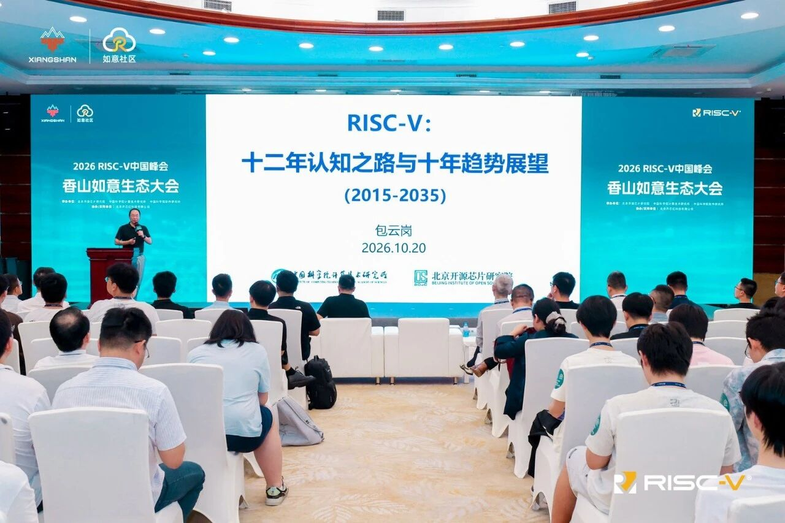
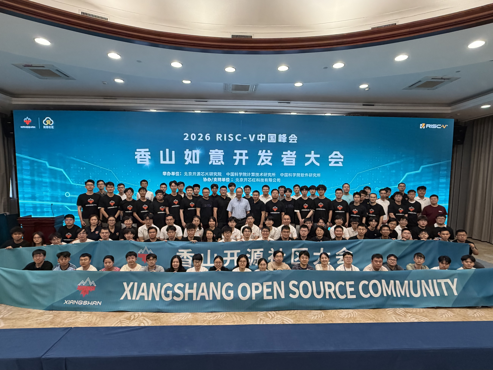

# 【香山双周报 114】20261028 期

欢迎来到香山双周报专栏，我们将通过这一专栏定期介绍香山的开发进展。本次是第 114 期双周报。

2026 RISC-V 中国峰会已于 10 月 18 日至 20 日在深圳会展中心（福田）成功举办。中国科学院计算技术研究所副所长、北京开源芯片研究院首席科学家包云岗研究员在香山如意生态大会上作了题为《RISC-V：十二年认知之路与十年趋势展望（2015-2035）》的报告，回顾 RISC-V 的发展历程，展望至 2035 年的产业趋势，并分享了对开源芯片技术与产业演进的见解。

峰会期间，香山团队举办了香山处理器专场，介绍了香山处理器的高性能架构演进与工业级验证实践。该专场的演讲 PPT 现已全部公开，欢迎访问 [Talks-and-Publications](https://github.com/OpenXiangShan/Talks-and-Publications)。

关于香山近期开发进展，前端修复地址符号扩展、ICache ECC 检查及异常传递问题；后端补齐新译码单元对 `mnret`、`dret` 指令的支持，并将默认 ROB 容量扩大至 160 项；访存与缓存推进 CoupledL2 分 bank 设计和专用 L1–L2 互连，修复 StoreQueue 转发与异常地址报告问题；XSAI 支持 CUTE 独立异步时钟域，优化多通道访存调度与矩阵寄存器写入，并完善矩阵验证与调试工具；基础设施增强 FPGA DiffTest 并行检查和 trace 录制回放，完善昆明湖 V2 参考模型集成，修复向量存储异常处理问题并优化存储校验。

<!-- more -->

## 近期进展

### 前端

- Bug 修复
  - （V2）在 BPU、IFU 和 RAS 等通路中保留真实的 PC guard bit，修复 VS Bare / Sv48x4 地址被错误符号扩展导致的取指地址错误及 RAS 恢复后 `mepc` 被污染的问题（[#6720](https://github.com/OpenXiangShan/XiangShan/pull/6720)）
  - 为 ICache 数据 ECC 检查传递真实的取指块结束偏移，修复误将请求有效信号作为偏移导致的 bank 选择错误（[#6635](https://github.com/OpenXiangShan/XiangShan/pull/6635)）
  - 按取指请求分别传递 ICache 的 ITLB/PMP 和 TileLink 异常，修复第二个取指请求的异常传递，并按请求累积回填异常（[#6414](https://github.com/OpenXiangShan/XiangShan/pull/6414)）

### 后端

- Bug 修复
  - （V3）补齐新译码单元对 Smrnmi 扩展的 `mnret` 和 Sdext 扩展的 `dret` 指令的译码及微操作映射（[#6692](https://github.com/OpenXiangShan/XiangShan/pull/6692)）
- 性能优化
  - （V3）将默认 ROB 容量从 144 项扩大至 160 项（[#6730](https://github.com/OpenXiangShan/XiangShan/pull/6730)）

### 访存与缓存

- RTL 新特性
  - 为 CoupledL2 增加按 set 分 bank 的 Directory/Data SRAM、hint 队列背压及预取准入限制，并更新集成至 XiangShan（[XSCache #36](https://github.com/OpenXiangShan/XSCache/pull/36)、[#6738](https://github.com/OpenXiangShan/XiangShan/pull/6738)）
  - 以 CustomL1L2Fabric 替换通用 L1–L2 互连，并加入 miss 跟踪、资源预留和可取消的推测 A 通道缓冲，以缩短 DCache 到 L2 的请求路径（[#6713](https://github.com/OpenXiangShan/XiangShan/pull/6713)）
- Bug 修复
  - 在 StoreQueue 中比较同一候选域内的虚拟地址与物理地址匹配掩码，不一致时触发 replay，修复地址别名场景下 load 转发较旧 store 数据的问题（[#6693](https://github.com/OpenXiangShan/XiangShan/pull/6693)）
  - 将 TLB 返回的指针屏蔽后地址传入 StoreUnit 后续流水级，使 store 和 CBO 异常在 `mtval`/`stval` 中报告正确地址（[#6742](https://github.com/OpenXiangShan/XiangShan/pull/6742)）

### XSAI

- RTL 新特性
  - 支持 CUTE 独立异步时钟域（[CUTE #44](https://github.com/OpenXiangShan/CUTE/pull/44)、[XSAI #135](https://github.com/OpenXiangShan/XSAI/pull/135)）
  - 优化 CUTE 多通道访存调度与矩阵寄存器写入，完善相应 DiffTest 支持（[CUTE #46](https://github.com/OpenXiangShan/CUTE/pull/46)、[difftest #991](https://github.com/OpenXiangShan/difftest/pull/991)、[XSAI #136](https://github.com/OpenXiangShan/XSAI/pull/136)）
- Bug 修复
  - 修复 XSAICache HintQueue 容量预留与重试处理问题，恢复矩阵预取总开关的控制作用（[XSAICache #10](https://github.com/OpenXiangShan/XSAICache/pull/10)）
- 调试工具
  - 加速 NEMU 矩阵寄存器 hash 计算（[NEMU #1248](https://github.com/OpenXiangShan/NEMU/pull/1248)）
  - 为矩阵 CSR 和配置状态启用 DiffTest Delta 传输（[difftest #985](https://github.com/OpenXiangShan/difftest/pull/985)、[XSAI #134](https://github.com/OpenXiangShan/XSAI/pull/134)）
  - 修复 NEMU 矩阵存储回滚时的内存恢复不完整问题（[NEMU #1251](https://github.com/OpenXiangShan/NEMU/pull/1251)）
  - 修复 DiffTest Replay 在反压下重复记录和跳过事件的问题（[difftest #990](https://github.com/OpenXiangShan/difftest/pull/990)）
  - 优化 DiffTest MMA 验证后端的内存管理、数据拷贝与计算内核（[difftest #994](https://github.com/OpenXiangShan/difftest/pull/994)、[difftest #996](https://github.com/OpenXiangShan/difftest/pull/996)、[difftest #999](https://github.com/OpenXiangShan/difftest/pull/999)、[difftest #1000](https://github.com/OpenXiangShan/difftest/pull/1000)、[difftest #1001](https://github.com/OpenXiangShan/difftest/pull/1001)、[difftest #1002](https://github.com/OpenXiangShan/difftest/pull/1002)）
  - 完善 xsai-env 可选源码与测试依赖初始化（[xsai-env #1](https://github.com/OpenXiangShan/xsai-env/pull/1)、[xsai-env #2](https://github.com/OpenXiangShan/xsai-env/pull/2)）
- 代码质量
  - 重构 NEMU 矩阵访存接口，分离事件分发与物理内存访问（[NEMU #1249](https://github.com/OpenXiangShan/NEMU/pull/1249)）

### 基础设施

- FPGA DiffTest
  - 新增可动态切换的 FAST/SLOW 参考执行模式，并在单核 XDMA 配置下支持基于 fork 的并行检查，由 SLOW 进程完整检查 DUT、按段确认结果，并在 FAST 执行分歧时接替（[difftest #980](https://github.com/OpenXiangShan/difftest/pull/980)、[NEMU #1247](https://github.com/OpenXiangShan/NEMU/pull/1247)）
  - 支持单核 REF-driving trace 的录制与独立回放，记录 SLOW、FAST 和 FORK 模式下驱动参考模型的 DUT 窗口，支持普通及 ZSTD 压缩格式（[difftest #981](https://github.com/OpenXiangShan/difftest/pull/981)）
  - 支持 BOOM 的 DiffTest 配置和 FPGA 板级接口，适配首条指令比较及启动超时，统一 CPU 侧 AXI 位宽，并将内存和 MMIO 接口分别连接至 DDR 与 UART16550（[difftest #998](https://github.com/OpenXiangShan/difftest/pull/998)、[env-scripts #192](https://github.com/OpenXiangShan/env-scripts/pull/192)、[rocket-chip #46](https://github.com/OpenXiangShan/rocket-chip/pull/46)）
- NEMU 参考模型
  - 在主线新增昆明湖 V2 单核、双核 REF、调试 REF 及独立运行配置，将参考模型纳入 CI 构建与发布，并以独立功能配置区分 V2/V3 行为差异，同步 HLVX 权限、LR 原子访问权限、双重陷阱及向量存储状态等公共修复（[NEMU #1246](https://github.com/OpenXiangShan/NEMU/pull/1246)）
  - 修复非 segment、单位步长向量存储跨页遇到异常时首个页面写入丢失的问题，保留已完成的部分写入及对应 DiffTest 存储记录，并同步至主线和昆明湖 V2 分支（[NEMU #1240](https://github.com/OpenXiangShan/NEMU/pull/1240)、[NEMU #1241](https://github.com/OpenXiangShan/NEMU/pull/1241)）
  - 优化 StoreHash 的 CRC 软件校验，将逐半字节查表改为按 64 位字折叠计算，降低存储记录校验开销（[NEMU #1252](https://github.com/OpenXiangShan/NEMU/pull/1252)）
  - 按基础配置、处理器版本和功能片段分层组织 NEMU 配置，减少公共设置重复，并新增 `make config-check` 检查配置组合、依赖及实际生效值（[NEMU #1259](https://github.com/OpenXiangShan/NEMU/pull/1259)）
  - 将 diff-spike 配置的客户机内存扩展至 32 GiB，并在初始化时同步参考模型内存大小，修复 SPEC checkpoint 因镜像超过内存容量而加载失败的问题（[NEMU #1267](https://github.com/OpenXiangShan/NEMU/pull/1267)）
- 测试负载及采样切片
  - 新增 BOOM v4 DiffTest 平台设备树，描述 ISA、内存及外设配置，支持通过 `DEFAULT_DTB=boom` 选择 Linux 负载构建目标（[workload-builder #81](https://github.com/OpenXiangShan/workload-builder/pull/81)）
- 开发与调试工具
  - 为 HPM 事件增加跨模块传递的描述元数据，补充 TL/CHI L2 事件说明，并提供 `hpm.csv` 导出工具（[Utility #157](https://github.com/OpenXiangShan/Utility/pull/157)、[CoupledL2 #527](https://github.com/OpenXiangShan/CoupledL2/pull/527)）
  - 修复共享检查器和 REF-driving trace 录制代码的 C++11 构建兼容性，恢复现有 `libdifftest.so` 构建流程（[difftest #1003](https://github.com/OpenXiangShan/difftest/pull/1003)）
- GSIM 仿真器
  - 支持生成 FST 仿真波形，提供波形开关、输出路径及数组规模和次态信号过滤选项，便于调试仿真行为（[gsim #109](https://github.com/OpenXiangShan/gsim/pull/109)）
  - 支持 `%b` 二进制格式输出，修复 Chisel `Binary` 格式打印触发断言的问题（[gsim #142](https://github.com/OpenXiangShan/gsim/pull/142)）

### XS-GEM5

- 模拟器对齐
  - 对齐 XsStream 预取器的活跃区域判断（[XS-GEM5 #1223](https://github.com/OpenXiangShan/GEM5/pull/1223)）
  - 启用每线程 MBTB victim cache 并修复共享 MBTB 写入时的失效行为（[XS-GEM5 #1235](https://github.com/OpenXiangShan/GEM5/pull/1235)、[XS-GEM5 #1236](https://github.com/OpenXiangShan/GEM5/pull/1236)）
- 新特性探索
  - 增加 MLP-aware SMT 取指策略并重构 BlockStall 策略（[XS-GEM5 #1180](https://github.com/OpenXiangShan/GEM5/pull/1180)）[感谢来自阿里同事的贡献]
  - 增加 SpMT 中端资源分区支持（[XS-GEM5 #1231](https://github.com/OpenXiangShan/GEM5/pull/1231)）[感谢来自阿里同事的贡献]
  - 增加 Hybrid CROB 支持（[XS-GEM5 #1189](https://github.com/OpenXiangShan/GEM5/pull/1189)）
- Bug 修复
  - 修复延迟地址翻译时访存宽度未初始化的问题（[XS-GEM5 #1214](https://github.com/OpenXiangShan/GEM5/pull/1214)）
  - 修复 store/AMO 发送失败时错误设置 load replay 状态的问题（[XS-GEM5 #1241](https://github.com/OpenXiangShan/GEM5/pull/1241)）[感谢来自阿里同事的贡献]
  - 修复 SMT LSQ DynamicBorrowing donor 检测（[XS-GEM5 #1257](https://github.com/OpenXiangShan/GEM5/pull/1257)）[感谢来自阿里同事的贡献]
  - 修复 decode efficiency 和 L2 TLB L0 miss 统计（[XS-GEM5 #1215](https://github.com/OpenXiangShan/GEM5/pull/1215)）
- 基础设施
  - 支持 RISC-V Zimop 指令（[XS-GEM5 #1224](https://github.com/OpenXiangShan/GEM5/pull/1224)）
  - 完善 trace 模式回归与 TRACERTL/NEMU trace 支持（[XS-GEM5 #1210](https://github.com/OpenXiangShan/GEM5/pull/1210)、[XS-GEM5 #1211](https://github.com/OpenXiangShan/GEM5/pull/1211)、[XS-GEM5 #1227](https://github.com/OpenXiangShan/GEM5/pull/1227)）
  - 恢复 macOS 构建并增加手动 smoke CI（[XS-GEM5 #1228](https://github.com/OpenXiangShan/GEM5/pull/1228)）
  - 完善每周性能回归和 PR Quick Check（[XS-GEM5 #1233](https://github.com/OpenXiangShan/GEM5/pull/1233)、[XS-GEM5 #1237](https://github.com/OpenXiangShan/GEM5/pull/1237)）

## 性能评估

<!-- TODO: 核对处理器、SoC 及完整编译参数配置。 -->
<!-- 数据来源：cr261023-f85a1f71d-DefaultConfig/score-spec06-rva23-novec-gcc16-1.0c.txt 和 score-spec06-rv64gcb-xscc-1.0c.txt；原始每 GHz 分数乘以 3，保留两位小数。 -->

处理器及 SoC 参数如下所示：

| 参数      | 选项       |
| --------- | ---------- |
| commit    | f85a1f71d  |
| 日期      | 2026/10/23 |
| L1 ICache | 64 KB      |
| L1 DCache | 64 KB      |
| L2 Cache  | 2 MB       |
| L3 Cache  | 32 MB      |
| 访存单元  | 3ld2st     |
| 总线协议  | CHI        |
| 内存配置  | DDR4-3200  |

性能数据如下所示：

| SPECint 2006 @ 3 GHz | GCC16  | XSCC   | SPECfp 2006 @ 3 GHz | GCC16  | XSCC   |
| :------------------- | :----: | :----: | :------------------ | :----: | :----: |
| 400.perlbench        | 57.53  | 60.40  | 410.bwaves          | 146.72 | 150.20 |
| 401.bzip2            | 30.95  | 32.28  | 416.gamess          | 61.81  | 57.66  |
| 403.gcc              | 64.24  | 62.22  | 433.milc            | 77.21  | 74.60  |
| 429.mcf              | 84.00  | 79.38  | 434.zeusmp          | 78.97  | 78.48  |
| 445.gobmk            | 45.78  | 44.21  | 435.gromacs         | 43.31  | 42.56  |
| 456.hmmer            | 55.18  | 67.22  | 436.cactusADM       | 89.34  | 95.97  |
| 458.sjeng            | 45.02  | 46.60  | 437.leslie3d        | 68.38  | 67.27  |
| 462.libquantum       | 167.32 | 381.31 | 444.namd            | 47.58  | 48.50  |
| 464.h264ref          | 69.68  | 73.92  | 447.dealII          | 85.14  | 163.77 |
| 471.omnetpp          | 59.22  | 60.62  | 450.soplex          | 69.18  | 80.89  |
| 473.astar            | 34.86  | 33.78  | 453.povray          | 79.90  | 69.32  |
| 483.xalancbmk        | 91.13  | 136.41 | 454.calculix        | 47.76  | 47.60  |
| GEOMEAN              | 60.48  | 68.41  | 459.GemsFDTD        | 82.64  | 82.59  |
|                      |        |        | 465.tonto           | 60.73  | 51.96  |
|                      |        |        | 470.lbm             | 128.11 | 151.49 |
|                      |        |        | 481.wrf             | 62.47  | 61.18  |
|                      |        |        | 482.sphinx3         | 68.15  | 98.99  |
|                      |        |        | GEOMEAN             | 72.56  | 76.95  |

编译参数如下所示：

| 参数          | GCC16                      | XSCC                |
| ------------- | -------------------------- | ------------------- |
| 编译器        | gcc16                      | xscc                |
| 编译优化      | O3                         | O3                  |
| 内存库        | jemalloc                   | jemalloc            |
| 指令集配置    | 基于 RVA23（禁用向量扩展） | RV64GCB             |
| -ffp-contract | fast                       | fast                |
| 链接优化      | -flto                      | -flto               |
| 浮点优化      | -ffast-math                | -ffast-math         |
| -mcpu         | -                          | xiangshan-kunminghu |

注：我们使用 SimPoint 对程序进行采样，基于我们自定义的 checkpoint 格式制作检查点镜像，SimPoint 聚类的覆盖率为 100%。上述分数为基于程序片段的分数估计，非完整 SPEC CPU2006 评估，和真实芯片实际性能可能存在偏差。

## 相关链接

- 香山技术讨论 QQ 群：879550595
- 香山技术讨论网站：<https://github.com/OpenXiangShan/XiangShan/discussions>
- 香山文档：<https://docs.xiangshan.cc/>
- 香山用户手册：<https://docs.xiangshan.cc/projects/user-guide/>
- 香山设计文档：<https://docs.xiangshan.cc/projects/design/>

编辑：李衍君、曾锦鸿、杨泽辰、张韩乐、游昆霖、李昕、燕翼鸣
