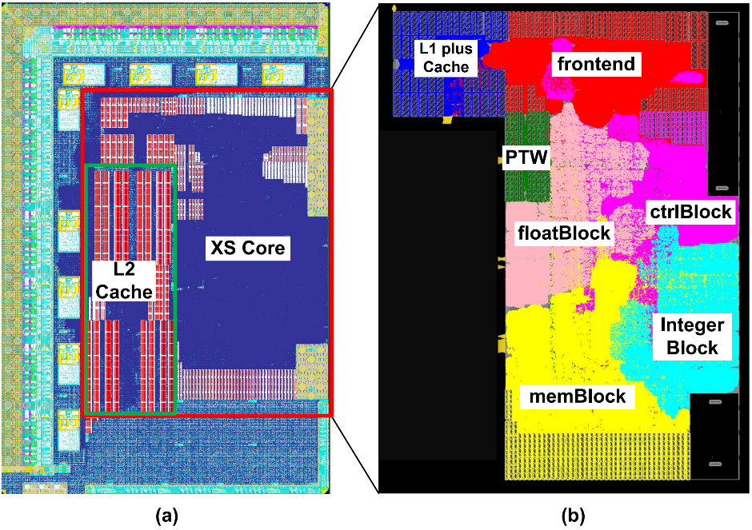
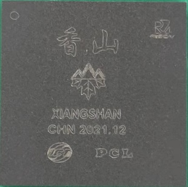
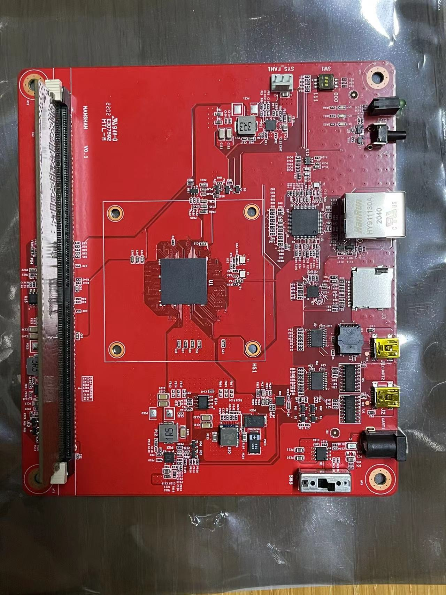
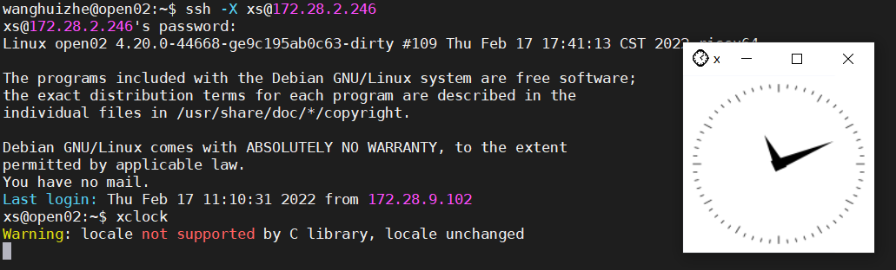
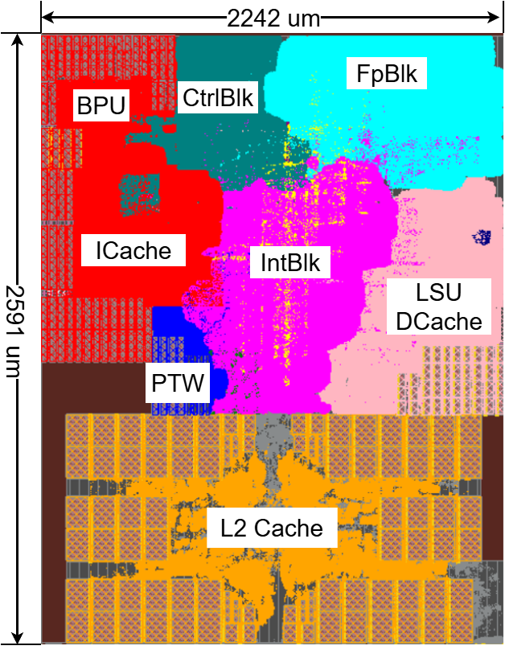
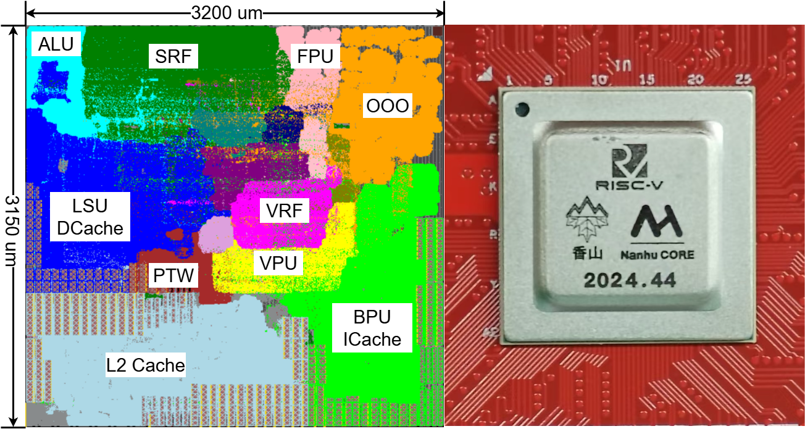
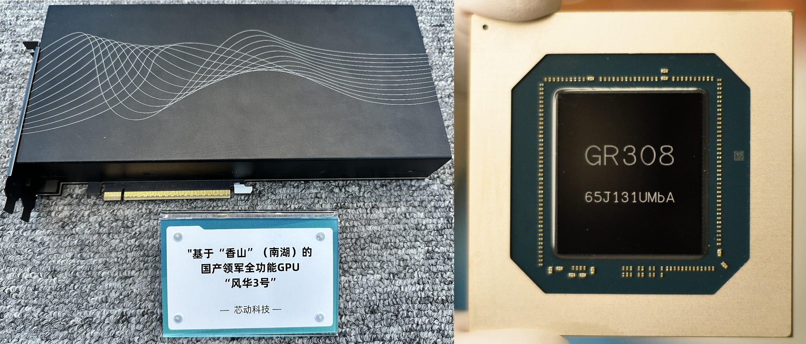
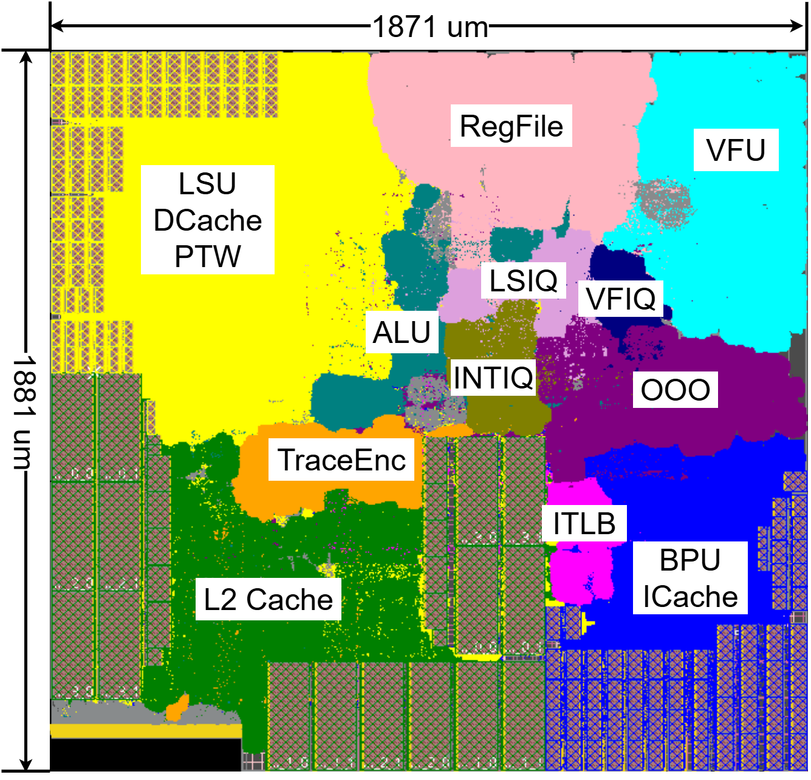
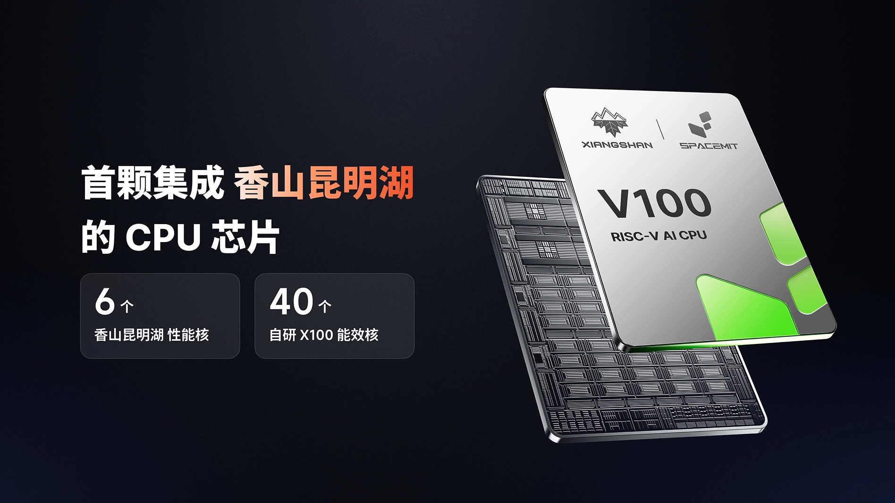

# 流片情况 Tape-out

## Gen1: 雁栖湖 Yanqihu (YQH)

第一代香山处理器，代号雁栖湖 (YQH)，由香山团队联合[微核芯](https://www.rvcore.com/)和[鹏城实验室](https://www.pcl.ac.cn/)于 2021 年 7 月交付流片，并于 2022 年 1 月回片。在 28nm 工艺下达到 1.3GHz，可以成功运行 Debian 操作系统。实测性能达到 7.03/GHz@SPECint2006、7.00/GHz@SPECfp2006。

The first-generation XiangShan processor, codenamed Yanqihu (YQH), was taped out in July 2021 by the XiangShan team in collaboration with [VCORE](https://www.rvcore.com/) and [PengCheng Laboratory](https://www.pcl.ac.cn/) and returned in January 2022. It can achieve 1.3GHz on a 28nm process, successfully run the Debian operating system. Its measured performance reaches 7.03/GHz@SPECint2006 and 7.00/GHz@SPECfp2006.

## Gen2: 南湖 Nanhu (NH)

第二代香山处理器，代号南湖 (NH)，由雁栖湖发展而来，于 2022 年完成初版架构设计。香山团队联合开芯红在此基础上迭代了南湖 V2、V3 和 V5 三代核心，在保持单核 10/GHz@SPECint2006 性能水平的基础上，引入新功能支持并持续优化能效。

The second-generation XiangShan processor, codenamed Nanhu (NH), evolved from YQH. Its initial architectural design was completed in 2022. Building on this work, the XiangShan team in collaboration with Beijing Kaixinhong Technology developed three successive generations of Nanhu cores (V2, V3, and V5), introducing new features and steadily improving power efficiency while maintaining a single-core performance level of 10/GHz@SPECint2006.

### 南湖V2 Nanhu-V2

南湖 V2 是南湖架构的首个正式版本，于 2023 年完成代码冻结。南湖 V2 核心在基于 14 nm 工艺的测试芯片上，在 typical/0.9V/85°C 工艺角下可以达到 2GHz 主频。

Nanhu V2, the first official version of the Nanhu architecture, was code-frozen in 2023. On a test chip fabricated in a 14nm process, the Nanhu V2 core can achieve a 2GHz frequency at the typical/0.9V/85°C process corner.

公司 A 将南湖 V2 集成到其产品中，已实现十万量级量产出货。

Company A has integrated Nanhu V2 into its products and has achieved mass production shipments in the region of 100,000 units.

公司 B 也进行了测试芯片的流片工作。

Company B has also conducted tape-out projects for test chips.

### 南湖V3 Nanhu-V3

南湖 V3 在 V2 的基础上做了三大方面改进：提升能效、支持 RVV1.0 指令集，以及增加面向量产的测试设计，并于 2024 年第一季度冻结。南湖 V3 核心的裁剪版在基于 28nm 工艺的测试芯片上，在 typical/0.9V/85°C 工艺角下可以达到 1.5GHz 主频。

Nanhu V3 is built on V2 with three major improvements: higher power efficiency, support for the RVV1.0 instruction set, and additional production-oriented test designs. The Nanhu V3 architecture was frozen in 2024Q1. The cut-down version of the Nanhu V3 core can achieve a 1.5GHz frequency on a test chip fabricated in a 28nm process at the typical/0.9V/85°C process corner.

芯动科技公司在其于 2025 年第三季度发布的[风华 3 号](https://www.fantasyxpu.com/product/g3) GPU 中集成了南湖 V3 核心，用于 GPU 的管理与调度。

Innosilicon integrated Nanhu V3 cores into its [Fantasy 3](https://www.fantasyxpu.com/product/g3) GPU, released in 2025Q3, for GPU management and scheduling.

> Translation of the image:
>
> A leading domestic full-featured GPU based on "XiangShan" (Nanhu)
>
> "Fantasy 3"
>
> — Innosilicon —

此外，公司 B 也进行了测试芯片的流片工作。

Furthermore, Company B has also conducted tape-out projects for test chips.

### 南湖V5 Nanhu-V5

南湖 V5 在 V3 的基础上进一步改进：引入了[昆明湖](#gen3-昆明湖-kunminghu-kmh)架构的部分技术，增加了对 RVA23 指令集的支持和功耗控制功能，并改用 AMBA CHI 接口。该架构于 2025 年第四季度冻结。南湖 V5 核心在基于 12 nm 工艺的测试芯片上，在 typical/1.0V/85°C 工艺角下可以达到 2 GHz 主频。

Nanhu V5 builds on V3 with further improvements: it introduces some technologies from the [Kunminghu](#gen3-昆明湖-kunminghu-kmh) architecture, adds RVA23 support and power-management features, and switches to the AMBA CHI interface. The Nanhu V5 architecture was frozen in 2025Q4. The Nanhu V5 core can achieve a 2GHz frequency on a test chip fabricated in a 12nm process at the typical/1.0V/85°C process corner.

## Gen3: 昆明湖 Kunminghu (KMH)

第三代香山处理器，代号昆明湖 (KMH)，面向高性能服务器应用场景，由初代南湖架构演进而来。它完整支持 RVA23 指令集，并持续提高性能、进行 PPA 优化。

The third-generation XiangShan processor, codenamed Kunminghu (KMH), evolved from the initial Nanhu architecture for high-performance server applications. It fully supports the RVA23 instruction set and continues to improve performance and optimize PPA.

### 昆明湖V1 Kunminghu-V1

昆明湖 V1 是昆明湖架构的首个冻结版本，未正式交付。公司 C 进行了测试芯片的流片。

Kunminghu V1 is the first frozen version of the Kunminghu architecture, which was not officially delivered. Company C has conducted tape-out projects for test chips.

### 昆明湖V2 Kunminghu-V2

昆明湖 V2 是昆明湖架构的首个正式版本。香山团队与多个合作伙伴联合推进了多个流片项目。

Kunminghu V2 is the first official version of the Kunminghu architecture. The XiangShan team worked with multiple partners to advance several tape-out projects.

进迭时空公司在其于 2026 年第三季度发布的 [V100](https://www.spacemit.com/products/keystone/v100) 服务器芯片中集成了六个昆明湖 V2 性能核心，实测单核性能超过 15/GHz@SPECint2006，最高主频 2.1GHz。

SpacemiT integrated six Kunminghu V2 performance cores into its [V100](https://www.spacemit.com/products/keystone/v100) server chip, released in 2026Q3. Its measured single-core performance exceeds 15/GHz@SPECint2006, with a maximum clock frequency of 2.1GHz.

> Translation of the image:
>
> The first CPU chip to integrate XiangShan Kunminghu, featuring six Kunminghu performance cores and 40 self-developed X100 efficiency cores.

> Translation of the image:
>
> RISC-V Server-class AI CPU Chip V100
>
> Developed by SpacemiT (Beijing) Technology Co., Ltd.

我们仍在和多位合作伙伴共同推进昆明湖 V2 的流片工作，敬请关注后续发布。

We are still working with multiple partners to advance tape-out projects for Kunminghu V2. Please stay tuned for future announcements.

### 昆明湖V3 Kunminghu-V3

最新的昆明湖 V3 架构目前仍在演进中，敬请关注我们的[主仓库](https://github.com/OpenXiangShan/XiangShan)和[双周报](https://docs.xiangshan.cc/zh-cn/latest/blog/category/biweekly/)获取最新进展。

The latest Kunminghu V3 architecture is still under development. Please follow our [main repository](https://github.com/OpenXiangShan/XiangShan) and [biweekly reports](https://docs.xiangshan.cc/zh-cn/latest/blog/category/biweekly-en/) for the latest updates.
