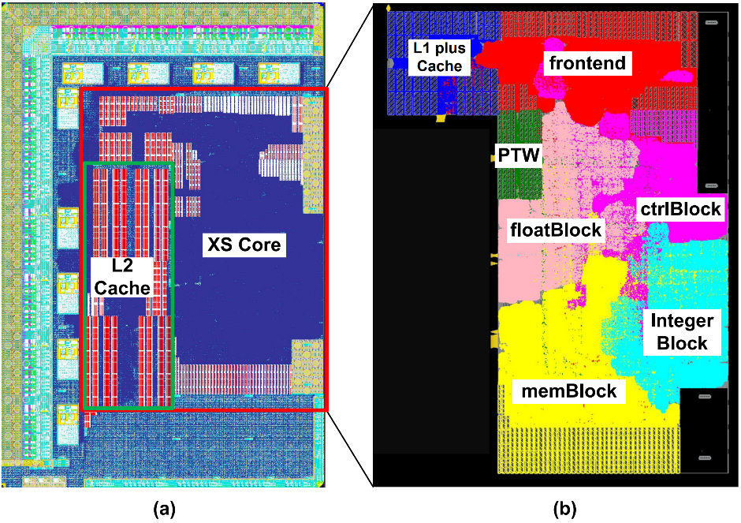
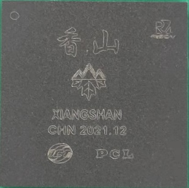
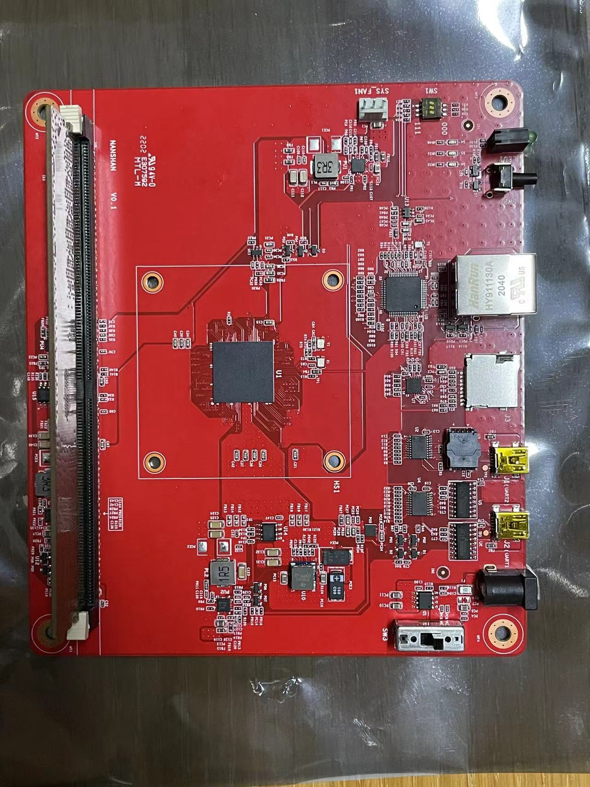
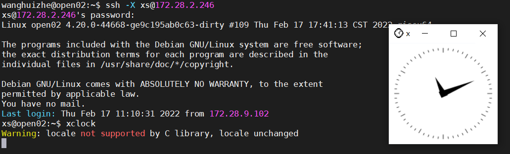

# 流片情况 Tape-out

## Gen1: 雁栖湖 Yanqihu

第一代香山处理器，代号雁栖湖，由香山团队联合[微核芯](https://www.rvcore.com/)和[鹏城实验室](https://www.pcl.ac.cn/)完成流片。目标 1.3GHz@28nm，于 2021 年 7 月交付流片，2022 年 1 月回片，实测性能达到 7.03/GHz@SPECint2006，7.00/GHz@SPECfp2006。成功运行 Debian 操作系统。

The first generation of XiangShan, codenamed Yanqihu, has been taped out by XiangShan team, collaborating with [VCORE](https://www.rvcore.com/) and [PengCheng Laboratory](https://www.pcl.ac.cn/). Targeting 1.3GHz@28nm, the tape-out was delivered in July 2021 and returned in January 2022. The measured performance reached 7.03/GHz@SPECint2006, 7.00/GHz@SPECfp2006. Successfully booted Debian.

## Gen2: 南湖 Nanhu

第二代香山处理器，代号南湖，在 2025 年第四季度由摩尔线程和芯动科技集成到最新一代 GPU 芯片中并流片，于 2026 年第一季度回片。

- 芯动科技 Innosilicon 风华3号 Fantasy 3
  - Link: <https://www.innosilicon.com.cn/gpu>
  - Link: <https://www.fantasyxpu.com/product/g3>

## Gen3: 昆明湖 Kunminghu

### 进迭时空 SpacemiT V100

Link: <https://www.spacemit.com/products/keystone/v100>
